

<picture><source media="(prefers-color-scheme: dark)" srcset="assets/dark/hero.svg"></picture>

<a href="https://lecodev-portafolio.vercel.app"><picture><source media="(prefers-color-scheme: dark)" srcset="assets/dark/b-web.svg"></picture></a>&nbsp;<a href="https://github.com/lecodev-26?tab=repositories"><picture><source media="(prefers-color-scheme: dark)" srcset="assets/dark/b-repos.svg"></picture></a>&nbsp;<a href="mailto:lecodev@outlook.es"><picture><source media="(prefers-color-scheme: dark)" srcset="assets/dark/b-mail.svg"></picture></a>&nbsp;<a href="https://github.com/Basekick-Labs/arc/pulls?q=is%3Apr+author%3Alecodev-26+is%3Amerged"><picture><source media="(prefers-color-scheme: dark)" srcset="assets/dark/b-arcprs.svg"></picture></a>

**Software, infrastructure and backend engineer in Barcelona.** I build the machinery behind the product: AI gateways, post-quantum cryptography and systems languages.

<picture><source media="(prefers-color-scheme: dark)" srcset="assets/dark/marquee.svg"></picture>

<picture><source media="(prefers-color-scheme: dark)" srcset="assets/dark/h-que.svg"></picture>

I am interested in the layer between software and infrastructure: the part that makes systems useful, controllable and resilient. I would rather build the machinery behind the product than another thin wrapper around an API.

| What I do | Where |
|---|---|
| AI gateways and LLM infrastructure | SentinelFlow |
| Security and cryptographic systems | NEXUS-Q · NEXUS-Q Tools |
| Programming languages and compilers | AXIOM |
| Runtime, compute and simulation | DINAH |
| Agents, tools and MCP | Genie |
| Time-series databases | Arc |
| Local and self-hosted software | Linux · Android · Termux |

<picture><source media="(prefers-color-scheme: dark)" srcset="assets/dark/h-proyectos.svg"></picture>

<picture><source media="(prefers-color-scheme: dark)" srcset="assets/dark/r-sentinelflow.svg">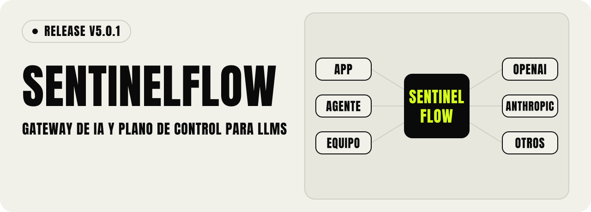</picture>

OpenAI-compatible gateway for teams that run several model providers. It brings intelligent routing, provider failover, policies, AI FinOps, security and observability into a single open source layer. Authentication, tenant isolation, quotas, audit and events.

`Go` `PostgreSQL` `Redis` `Docker` `Kubernetes` `Prometheus`

<picture><source media="(prefers-color-scheme: dark)" srcset="assets/dark/l-sentinelflow.svg"></picture> 
Go 87% · HTML 9% · Shell 2% · others 2%

- **Status:** V5.0.1 stable · V6 in development on the `v6` branch
- **License:** MIT
- **Last activity:** Oct 16, 2026

<a href="https://github.com/lecodev-26/sentinelflow"><picture><source media="(prefers-color-scheme: dark)" srcset="assets/dark/b-repo.svg"></picture></a>

<picture><source media="(prefers-color-scheme: dark)" srcset="assets/dark/r-nexus-q.svg">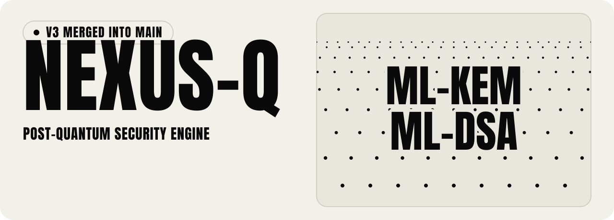</picture>

Rust post-quantum cryptographic security engine for data, keys and identities, with key lifecycle management, authenticated encryption, signatures, credentials, policy enforcement, audit logging and hardware-provider abstractions. The project includes security CI, fuzz targets, documented threat models, benchmarks and a PQC Benchmark Arena. **v4.1.2 is the current release.** It is an audit-ready release, not a production-readiness claim; no independent external audit or FIPS validation is claimed. The native ML-KEM/ML-DSA backend remains experimental and opt-in; RustCrypto is the default path.

`Rust` `ML-KEM-768` `ML-DSA-65` `SLH-DSA` `RISC-V` `Android` `SDKs`

<picture><source media="(prefers-color-scheme: dark)" srcset="assets/dark/l-nexus-q.svg"></picture> 
Rust 94% · C 3% · C++ 1% · Go, Shell, PHP, Ruby 2%

- **V1:** frozen baseline `v1.0.0`
- **V2:** frozen on `nexusqv2` (`v2.0.0`)
- **V3:** merged into `main` (PR #45)
- **V4:** `v4.1.2` current release · Audit-Ready Release · no production-readiness claim, no FIPS validation, external audit pending. Native backend remains experimental and opt-in; RustCrypto is the default.
- **Companion tools:** 25 independent Rust CLI tools built on the public `nexusq-core` API; all 25 crates are published on crates.io at `0.1.0`.
- **Last activity:** Oct 28, 2026

<a href="https://github.com/lecodev-26/nexus-q"><picture><source media="(prefers-color-scheme: dark)" srcset="assets/dark/b-repo.svg"></picture></a>&nbsp;<a href="https://github.com/lecodev-26/nexus-qtools"><picture><source media="(prefers-color-scheme: dark)" srcset="assets/dark/b-repo.svg"></picture></a>&nbsp;<a href="https://nexus-q.link"><picture><source media="(prefers-color-scheme: dark)" srcset="assets/dark/b-site.svg"></picture></a>&nbsp;<a href="https://github.com/lecodev-26/nexus-qtools/releases/latest"><picture><source media="(prefers-color-scheme: dark)" srcset="assets/dark/b-release.svg"></picture></a>

<picture><source media="(prefers-color-scheme: dark)" srcset="assets/dark/r-axiom.svg"></picture>

A general-purpose language with a small syntax and a deep semantic model. The long-term goal is its own compiler, runtime, ABI and self-hosted toolchain, so that AXIOM compiles AXIOM. Python and Rust are the transition infrastructure.

`Python` `Rust` `Compiler` `Runtime` `Systems`

<picture><source media="(prefers-color-scheme: dark)" srcset="assets/dark/l-axiom.svg"></picture> 
Python 51% · Rust 49%

- **Status:** architecture closed, now being implemented
- **License:** MIT
- **Last activity:** Oct 3, 2026

<a href="https://github.com/lecodev-26/axiom"><picture><source media="(prefers-color-scheme: dark)" srcset="assets/dark/b-repo.svg"></picture></a>

<picture><source media="(prefers-color-scheme: dark)" srcset="assets/dark/r-dinah.svg"></picture>

A Rust-first foundation for runtime execution, memory, compute, ECS, deterministic simulation and early networking. Core/runtime/memory/compute/ECS foundations, five bounded simulation models, initial blocking TCP wrappers and prediction/reconciliation/replay primitives are implemented. Networking wire encoding and full protocol integration remain unfinished; this is not a production-ready runtime or game engine.

`Rust` `Runtime` `Compute` `ECS` `Simulation` `Networking`

<picture><source media="(prefers-color-scheme: dark)" srcset="assets/dark/l-dinah.svg"></picture> 
Rust 100%

- **Status:** pre-alpha · active development
- **License:** MIT OR Apache-2.0
- **Last activity:** Oct 19, 2026

<a href="https://github.com/lecodev-26/dinah"><picture><source media="(prefers-color-scheme: dark)" srcset="assets/dark/b-repo.svg"></picture></a>&nbsp;<a href="https://github.com/lecodev-26/dinah/blob/main/roadmap.md"><picture><source media="(prefers-color-scheme: dark)" srcset="assets/dark/b-release.svg"></picture></a>

<picture><source media="(prefers-color-scheme: dark)" srcset="assets/dark/r-genie.svg"></picture>

A `SKILL.md` file with instructions that let an AI guess what you are thinking of, with no app and nothing to install. The questions adapt to your answers, a "not sure" counts as neither yes nor no, and it only takes a guess when it has enough evidence. It also includes a minimal remote MCP server for compatible AI clients.

`Markdown` `TypeScript` `MCP`

- **License:** MIT
- **Last activity:** Sep 29, 2026

<a href="https://github.com/lecodev-26/genie"><picture><source media="(prefers-color-scheme: dark)" srcset="assets/dark/b-repo.svg"></picture></a>&nbsp;<a href="https://github.com/lecodev-26/genie/releases/latest"><picture><source media="(prefers-color-scheme: dark)" srcset="assets/dark/b-release.svg"></picture></a>

<picture><source media="(prefers-color-scheme: dark)" srcset="assets/dark/r-nuvora.svg"></picture>

An experimental project with a Python backend and a JavaScript interface, deployed on Vercel. I keep it lightweight while the implementation evolves.

`Python` `JavaScript` `Vercel`

<picture><source media="(prefers-color-scheme: dark)" srcset="assets/dark/l-nuvora.svg"></picture> 
Python 74% · JavaScript 26%

- **Last activity:** Sep 28, 2026

<a href="https://nuvora-chi.vercel.app"><picture><source media="(prefers-color-scheme: dark)" srcset="assets/dark/b-demo.svg"></picture></a>&nbsp;<a href="https://github.com/lecodev-26/nuvora"><picture><source media="(prefers-color-scheme: dark)" srcset="assets/dark/b-repo.svg"></picture></a>

<picture><source media="(prefers-color-scheme: dark)" srcset="assets/dark/r-arc.svg">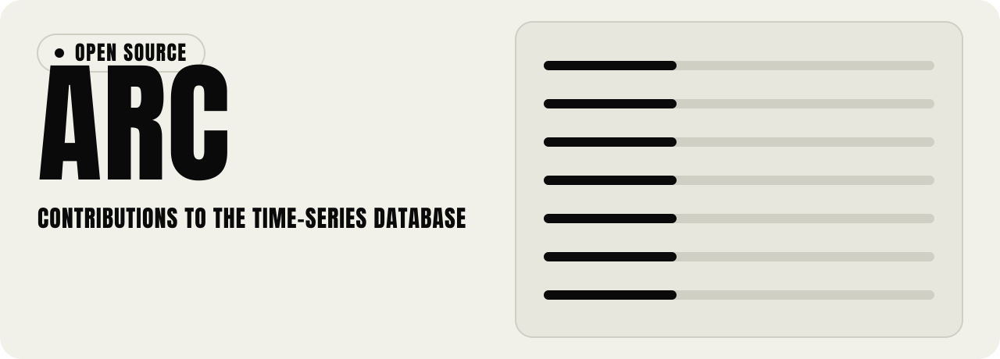</picture>

I contribute to Arc, by Basekick Labs: an open, SQL-native time-series database written in Go on top of DuckDB, built for high-throughput telemetry, Parquet storage and analytical SQL. I have **8 PRs merged into `main`**, covering the WAL, file replication, ingestion, retention policies, the tiering API and configuration.

`Go` `DuckDB` `WAL` `Parquet` `Ingestion`

- **PRs merged into main:** 8
- **Last merge:** Oct 29, 2026

<a href="https://github.com/Basekick-Labs/arc"><picture><source media="(prefers-color-scheme: dark)" srcset="assets/dark/b-arc.svg"></picture></a>

<picture><source media="(prefers-color-scheme: dark)" srcset="assets/dark/h-arc.svg"></picture>

Arc (Basekick Labs) is an AGPL-3.0 licensed SQL time-series database written in Go, with 686 stars. These are my changes that the maintainer has merged into its `main` branch, with the context of each review.

<picture><source media="(prefers-color-scheme: dark)" srcset="assets/dark/stats.svg">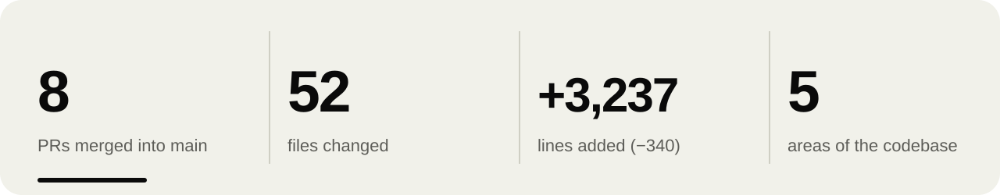</picture>

#### [#1052](https://github.com/Basekick-Labs/arc/pull/1052) · `feat(tiering): support filtered manual migrations`

**Merged into main** · Oct 29, 2026 · +319 −16 · 7 files

Adds database- and measurement-filtered manual tier migrations, validates the source and destination tiers while keeping the supported direction explicit as hot → cold, and makes `dry_run` report candidate count and bytes without moving files. The scheduled migration path remains unchanged. The PR adds focused coverage for filtered candidates and preview non-mutation; it was merged by the Arc maintainer after review.

#### [#1241](https://github.com/Basekick-Labs/arc/pull/1241) · `fix(config): remove dead license.enabled key`

**Merged into main** · Oct 13, 2026 · +12 −6 · 2 files · Closes #1195

Removed `license.enabled` from the config struct, loader and defaults because it was read but never used. Enterprise licensing continues to be driven by `license.file_path` or `license.key`; any leftover `license.enabled` setting or `ARC_LICENSE_ENABLED` environment variable remains ignored, so this is a cleanup with no behavior change.

#### [#1053](https://github.com/Basekick-Labs/arc/pull/1053) · `feat(retention): apply policies to cold tier`

**Merged into main** · Retention · Cold-tier storage

Retention policies now apply to data in the cold tier as well, bringing cold-tier lifecycle handling in line with Arc's retention rules instead of limiting policy enforcement to the hot tier.

#### [#1073](https://github.com/Basekick-Labs/arc/pull/1073) · `fix(filereplication): make rewritten files immutable`

**Merged into main** · Oct 8, 2026 · +623 −101 · 16 files · After 26.09.3 · Closes #975 · unblocks #1092

Partial DELETE rewrites no longer mutate the existing manifest entry: they publish a fresh Parquet file, register the new path and delete the old one in a single Raft batch, with the rewritten checksum and size and the rewriting node as the new origin. Before, a same-size rewrite could leave replicas trusting a stale file, because presence was checked by size only. It covers the live, replay and snapshot catch-up paths, and serializes concurrent partial DELETEs so they cannot publish several survivors from the same source. The maintainer noted that the approach was right from the first push. Benchmark on existing data: +0.26%, within the noise margin.

#### [#1051](https://github.com/Basekick-Labs/arc/pull/1051) · `fix(api): validate tiering file limits`

**Merged into main** · Oct 7, 2026 · +129 −21 · 2 files · After 26.09.3 · Fixes #1135

`GET /api/v1/tiering/files` rejects non-integer or negative `limit` values, which used to cause a panic when slicing with a negative index. I added a structural guard with a positive limit at the point of use, kept `limit=0` as an explicit empty result, and dropped the proposed cap of 1000 so the API stays backward compatible.

#### [#1055](https://github.com/Basekick-Labs/arc/pull/1055) · `fix(wal): line-protocol WAL entries carry their database envelope`

**Merged into main** · Oct 4, 2026 (merged Oct 5) · +137 −4 · 3 files · Release 26.09.3 · Fixes #889

Line-protocol writes reached the buffer as columns with no raw client bytes, so their WAL entry went out without a database and a receiver always filed it under "default". The row-format path now writes the same envelope that msgpack uses. It is safe for replay, receiver, checkpoints and large sizes, and readable by any binary since 26.05.1. During review the maintainer narrowed the scope: the change in `cmd/arc/main.go` (#886), which depended on #888, was dropped and only the #889 envelope was kept.

#### [#1056](https://github.com/Basekick-Labs/arc/pull/1056) · `fix(wal): purge only data proven flushed`

**Merged into main** · Oct 4, 2026 · +884 −156 · 8 files · Release 26.09.3 · Resolves #1009 / #966

Closes the remaining gap in WAL purging. It tracks pending identities through durable flush checkpoints, exposes a real minimum-unflushed sequence and uses `PurgeFlushed` instead of wall-clock age for periodic and recovery cleanup, so a file is deleted only once its data has been flushed. After review, a maintainer commit bounds the purge floor and reclaims files it cannot describe.

#### [#769](https://github.com/Basekick-Labs/arc/pull/769) · `fix(ingest): log numeric host coercion at debug level`

**Merged into main** · Sep 13, 2026 · +58 −2 · 3 files · Release 26.09.2 · Fixes #768

The fallback that coerces numeric values into `host_<num>` strings is intentional and stays, but it hid a sign of misconfigured clients. I added a debug-level log when it fires, so the hot ingest path is not flooded, and two test cases (float and boolean host) that fall through to the default branch. It went through three review rounds and the merge added me to the project contributors list.

Source: the public PR and release pages of Arc on GitHub and its API, as of October 29, 2026. All merges were done by the project maintainer. #769 shipped in 26.09.2, #1055 and #1056 in 26.09.3, and #1051, #1073, #1241 and #1052 were merged after 26.09.3, the latest published release.

<picture><source media="(prefers-color-scheme: dark)" srcset="assets/dark/h-crono.svg"></picture>

<picture><source media="(prefers-color-scheme: dark)" srcset="assets/dark/timeline.svg"></picture>

<picture><source media="(prefers-color-scheme: dark)" srcset="assets/dark/h-stack.svg"></picture>

<picture><source media="(prefers-color-scheme: dark)" srcset="assets/dark/stack.svg"></picture>

## 🐍 Contribution Snake

<picture><source media="(prefers-color-scheme: dark)" srcset="assets/dark/h-hablemos.svg"></picture>

<a href="mailto:lecodev@outlook.es"><picture><source media="(prefers-color-scheme: dark)" srcset="assets/dark/b-email2.svg"></picture></a>

lecodev · Barcelona · © 2026

